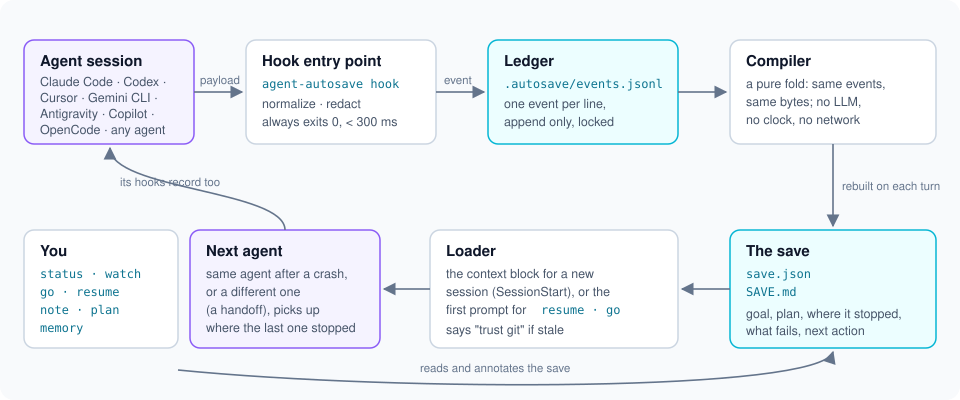

# Architecture

**Who it's for:** Contributors changing the code, who need the module map and the rules that keep hooks fast.

Read this before changing the code: which module does what, and the rules
that keep hooks fast and saves deterministic. One loop: an agent's hooks
send events, agent-autosave folds them into a save, and the save is handed
to the next session or agent. [How a save works](how-a-save-works.md)
follows one real event through it.



The same loop as text:

```text
agent hook ──► capture ──► ledger (events.jsonl) ──► compiler ──► save.json + SAVE.md
                                                                     │
next agent ◄── loader (context block, resume prompt) ◄───────────────┘
```

## Modules

| Module | Job |
| --- | --- |
| `capture.py` | The `hook` entrypoint. Reads the payload, calls the agent's normalizer, appends events, rebuilds when the event matters, prints the agent's hook output. Catches everything and exits 0. |
| `normalize/<agent>.py` | Turn one agent's hook payload into normalized events (`events.py` validates them). Per-session counters live in `.autosave/adapter-<agent>.json`. |
| `transcripts/codex.py` | Read the Codex rollout tail for facts its hooks lack: a command's exit code, a usage limit. |
| `ledger.py` | Append-only `events.jsonl` under a lock, rotation into `history/`. |
| `state.py` | `TaskStore`: task boundaries (init, clear, a prompt after `done`), archives, rebuilding the save. |
| `compiler.py` | A pure fold from events and git facts to the save. Reads no files and no clock. |
| `render.py` | The bounded `SAVE.md` view of a save. |
| `loader.py` | The context block an agent receives, and the `resume` prompt. |
| `gitstate.py`, `timeouts.py` | Read-only git facts with a timeout per call; the bound on that timeout and on agents' `--version` checks. Only the test suite and the docs and example builders lift the bound (`timeouts.LENIENT`, set in process or by `tests/tools/lenient_cli.py`), so a loaded machine never changes their output; no environment variable or setting does it for users. |
| `redact.py`, `storage.py`, `locking.py` | Secret redaction, private atomic writes, bounded locks. |
| `config.py` | Built-in defaults, then `~/.config/agent-autosave/config.json`, then `.autosave/config.json`. |
| `background.py` | The detached rebuild some SessionEnd hooks start. |
| `ui.py` | The terminal style every command shares: colour only on a terminal (off with `NO_COLOR`), symbols with an ASCII fallback, aligned fields. |
| `wizard/` | The `init` wizard: `flow` (the questions in order), `screen` (banner and layout), `widgets` (select, multi-select, confirm, text; arrow keys and space), `render` (answers to the list of files), `write` (atomic writes with a backup). |
| `cli.py`, `arguments.py`, `commands/`, `contract.py` | Dispatch (cli.py, which keeps the hook and status line paths free of argparse) and argument parsing (arguments.py); one module per command (plus `common` and `codex_layers`); the JSON envelope, error types and exit codes. |
| `installer/` | `detect`, `install`, `remove`, `doctor`, `upgrade`, the user-level `registry`, and `userhooks` for cleaning hooks out of user-level files. |
| `resources/<agent>/` | The adapter files the installer writes. They mirror the repository's `adapters/<agent>/`, so an installed wheel has them; a test keeps the two identical. |

The hook path imports only what it needs: an unsupported agent or a folder
without `.autosave/` never loads the compiler, and no hook ever loads
`ui.py`, `wizard/` or `commands/`. Tests check both, the second with an
import trace of a real hook (`tests/test_package.py`).

## Rebuilds

The compiler runs after a session start, a prompt, a failing tool call, a
turn end, an interruption and a compaction. A successful tool call only
appends: the next turn end rebuilds. SessionEnd settles the status in the
hook itself, reusing the last git facts, because Codex kills the hook's
process group once it returns. It then starts `background.py` to refresh the
git facts, which may or may not finish; the next session start rebuilds
anyway.

## Tasks

`TaskStore.start` begins a task and `start(reason="clear")` archives the
current one. A prompt after `done` starts a new task. Each boundary holds the
writer lock while it archives the compiled save, records the new task and
its ledger cursor, and writes empty snapshots. Events carry a `task_id`, so a
clear and a prompt in the same second cannot mix.

The loader's first line (`[agent-autosave resume context]`) also marks a
prompt as a resume: the compiler and `TaskStore.append` both recognize it, so
`resume` never archives the task it resumes. The string must stay identical.

Snapshots are atomic one by one, not as a set. `save.json` is authoritative;
a rebuild repairs a stale `SAVE.md`.

## Installation

Each adapter has a manifest (`adapters/<agent>/adapter.json`) listing the
files it touches and how: hooks merged into a JSON file, a managed block in
a Markdown file, or a file of our own. `install.json` records every
insertion with its owners, the folders it created and digests of the file
before and after, so `remove` can undo exactly that and leave the rest of
the file byte for byte. A file shared by two agents (`AGENTS.md` for Codex
and generic) keeps its block until the last owner goes. If a hooks file was
reformatted, `remove` finds our hooks by their command instead. If part of
an insertion was deleted by hand, `remove` leaves the rest and reports it in
`missing_spans` rather than guess; `doctor` and `add` repair it first.

User-level hooks (Codex `--user-level`) are shared by every repository on
the machine; the registry in `$XDG_CONFIG_HOME/agent-autosave/installs.json`
counts the repositories using them.

## Choices that differ from agentic-stack

agentic-stack inspired the layout: one local state folder, small adapters
described by manifests, separate install / audit / remove / upgrade verbs,
one JSON result on stdout. Where this project differs:

- Hooks and instruction blocks are merged into the user's files and removed
  byte for byte, instead of overwriting files.
- One task per working tree, compiled without an LLM. No memory graph,
  skills or orchestration.
- Hooks must fail open within 300 ms, so every lock and subprocess has a
  bounded wait.
- Redaction replaces the whole match (`[redacted:<kind>]`); captured state
  is private by default.
- `doctor` is read-only; repairs go through `add` and `upgrade`.

## See also

- [How a save works](how-a-save-works.md): the same loop, followed through one real event
- [Compiler](compiler.md): the fold from events to a save, rule by rule
- [Local format](format.md): every file the modules write
- [Contracts](contracts.md): the output and exit codes the CLI promises
